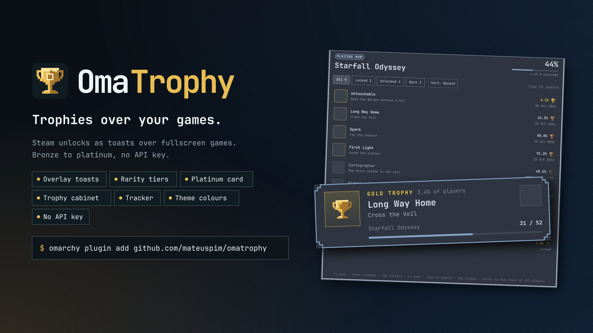

#  OmaTrophy



**Achievement unlocks as trophies over your games, on the Omarchy shell:
bronze, silver and gold by rarity, and a platinum moment when you finish a
game. No API key, works with a private Steam profile.**

## Quick start

```bash
omarchy plugin add https://github.com/mateuspim/omatrophy.git --enable
python3 ~/.config/omarchy/plugins/pym.omatrophy/omatrophy.py test gold
```

Unlock something in a game, or click the trophy in the bar: it shows the
game you're playing and what's left in it, and opens any game's full
achievement list.

## Features

- Toasts on the shell's Overlay layer, so they land over fullscreen games
  even when Steam's own popup doesn't. Click-through; never takes focus.
- About two seconds from unlock to toast: OmaTrophy reads Steam's local
  achievement cache, so no Steam Web API key and no public profile.
- Rarity picks the metal: bronze, silver at 35% of players or fewer, gold at
  10% or fewer, with glitter and a sweep of light for gold.
- A platinum card at 100%: the trophy spins in over the game's hero art and
  the count rolls up.
- The achievement icon, its description, the share of players, and your
  progress through the game, filling in as you watch.
- A trophy cabinet in the bar: the game you're playing with this session's
  unlocks and the likeliest next ones, or the last three games you played,
  and a shelf of your platinums; every game, eight to a page, filtered as you
  type and sorted by recent, closest to platinum or name, with games you
  won't finish set aside, and platinums you'd rather not show taken off
  the shelf.
- An achievement tracker over the screen: every achievement of a game with
  its rarity, the day you got it, and how far along a counter is ("52 /
  80"); filtered to locked, unlocked or rare, sorted, and searched as you
  type, by mouse or keyboard. Hidden ones stay hidden until you hover or
  press Enter.
- Three trophy styles: Omarchy (a pixel grid with an inlay in your theme
  accent), Faceted and Painted.
- Theme-native: cards draw from your Omarchy theme colours.
- A chime per tier, from a short tick for bronze to a ringing bloom for
  platinum, made for OmaTrophy; or the classic desktop sounds, or silence.
- Top centre, top left or top right.
- Built for more stores than Steam: each one is a small module
  ([adding a store](docs/guide/stores.md)).

## Install

```bash
omarchy plugin add https://github.com/mateuspim/omatrophy.git --enable
```

This places a trophy button in the bar. If it doesn't show, run
`omarchy restart shell` once (not while a game runs).

## Remove

```bash
omarchy plugin remove pym.omatrophy
rm -rf ~/.config/omatrophy ~/.local/state/omatrophy ~/.cache/omatrophy
```

## Security and privileges

OmaTrophy runs inside `omarchy-shell` as your user. It reads Steam's local
achievement cache, keeps its settings and a small cache in its own folders,
and calls Steam's public endpoints for rarity, game names and art when a
toast shows, the bar panel opens or the watcher starts (game names, once
each). No root, no API key, no login. Details in
[SECURITY.md](SECURITY.md).

## Trophy cabinet and tracker

Click the trophy in the bar. The **Now** tab shows your totals, then the game
you're playing: its art and progress, what you've unlocked this session and
the three locked achievements most players have. With nothing running it
shows the last three games you played instead (a finished one carries its
platinum date). Below sits your platinum shelf. The **Games** tab lists every
game with its count, sorted by last played, closest to platinum or name.
Type (or press `/`) to filter by name; Enter opens the first match. Hover a
game and click **Hide** to set aside one you won't finish: it leaves
Closest and dims in the other sorts until you click **Show**.

Click any game for the **tracker**, a card over the screen with every
achievement: rarity, the trophy it would earn, and the date you got it.
Locked counter achievements show how far along you are ("52 / 80") when
the game tracks the count. Its keys:

| Key | Does |
| --- | --- |
| Up, Down, Page Up/Down, Home, End | Move the highlight |
| Enter (or Space, when not searching) | Reveal a hidden achievement |
| Tab, Shift+Tab | All, Locked, Unlocked, Rare |
| Left, Right | Sort: recent, rarest, A–Z, the game's own order (remembered) |
| Any letter | Search; Backspace edits |
| Escape | Clear the search, then close |

From a script:

```bash
omarchy-shell shell summon pym.omatrophy '{}'   # the running or last game
```

## Settings

The panel's **Settings** tab holds the trophy style, previews of every tier,
position, glass and sound. Each choice applies to the next toast. Steam
also shows its own popup for each unlock; **Turn off in Steam** opens
Steam's settings so you can switch those off under Notifications.

From a terminal:

```bash
omatrophy.py set position top-right     # top-center, top-left, top-right
omatrophy.py set sound off              # on, off, omatrophy, classic
omatrophy.py set icons vector           # omarchy, vector, painted
omatrophy.py set glass clear            # clear, frosted, solid
omatrophy.py hide steam 20920           # out of "closest to platinum" and the shelf; unhide brings it back
omatrophy.py test platinum              # bronze, silver, gold, platinum
omatrophy.py status                     # progress of every game
omatrophy.py now                        # the panel's Now tab, as JSON
omatrophy.py game                       # every achievement of the running game
```

The full command list is in [docs/specs/cli.md](docs/specs/cli.md), the
settings file in [docs/specs/settings.md](docs/specs/settings.md).

## Game stores

Steam is supported today, native or Flatpak; set `STEAM_DIR` if yours lives
elsewhere.

Steam keeps a game's achievements on disk only once that game has run on
this machine, so a fresh install shows just a few games. If your profile
and game details are public, fill in the rest from your Steam Community
profile:

```bash
omatrophy.py set community on   # off by default; sends your SteamID64 to steamcommunity.com
omatrophy.py sync               # optional: fetch now with progress (the watcher also does it)
```

Steam limits how fast a profile can be read, so the watcher fetches 15
games an hour and a large library fills in over a day or two. Toasts still
come only from this machine's own data. Other launchers plug in as one module each:
[adding a store](docs/guide/stores.md).

## Requirements

- Omarchy 4.0+ with the Quickshell-based `omarchy-shell`
- Python 3 (standard library only)
- Steam, with games that have achievements
- PipeWire (`pw-play`) for the chime

## Documentation

- [Documentation index](docs/README.md): architecture, decisions, specs and
  runbooks.
- [Troubleshooting](docs/runbooks/troubleshooting.md).
- [Contributing](CONTRIBUTING.md) and [Security](SECURITY.md).

## Development

Link a checkout to `~/.config/omarchy/plugins/pym.omatrophy`, then run
`python3 -m unittest discover -s tests` and `omarchy plugin validate .`.
Preview cards without touching the live shell with `dev/preview.sh`, or
render any view to a PNG with `dev/render.sh`.
Everything is in the [development runbook](docs/runbooks/development.md).

## License

MIT. See [LICENSE](LICENSE).
